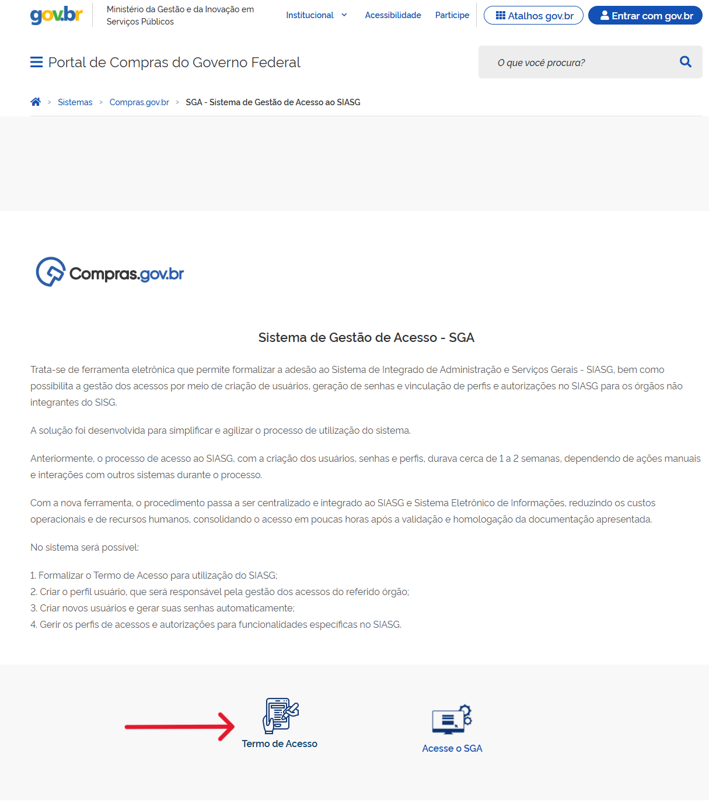

  Tamanho do texto:
  <button onclick="diminuirFonte()" title="Diminuir texto" style="padding: 6px 12px; font-weight: bold; cursor: pointer; border: 1px solid #ccc; border-radius: 4px; background: #f8f9fa;">A-</button>
  <button onclick="resetarFonte()" title="Tamanho normal" style="padding: 6px 12px; font-weight: bold; cursor: pointer; border: 1px solid #ccc; border-radius: 4px; background: #f8f9fa;">A</button>
  <button onclick="aumentarFonte()" title="Aumentar texto" style="padding: 6px 12px; font-weight: bold; cursor: pointer; border: 1px solid #ccc; border-radius: 4px; background: #f8f9fa;">A+</button>
  
  <button onclick="window.print()" style="background-color: #0056b3; color: white; padding: 6px 16px; border: none; border-radius: 5px; font-size: 14px; cursor: pointer; box-shadow: 0 2px 4px rgba(0,0,0,0.2); margin-left: 10px;">
    🖨️ Imprimir ou baixar esta página
  </button>

<h1 id="secao-1" style="margin-top: 0;">1. MEU ÓRGÃO PRECISA ADERIR AO SGA?</h1>

!!! note "RESPOSTA RÁPIDA"
    Órgãos e entidades federais integrantes do Sistema de Serviços Gerais (SISG) não precisam solicitar adesão pelo SGA. Os demais, de modo geral, precisam.

## Situação do Órgão ou Entidade

| SITUAÇÃO DO ÓRGÃO OU ENTIDADE | PRECISA SOLICITAR ADESÃO? |
| :--- | :--- |
| **Administração Pública Federal direta, autarquias e fundações públicas federais integrantes do SISG** | Não. Não precisam solicitar adesão pelo SGA. |
| **Órgãos e entidades estaduais e municipais** | De modo geral, sim. |
| **Empresas públicas e sociedades de economia mista** | Sim, conforme as regras aplicáveis a esse tipo de entidade. Confirme eventuais exceções na regulamentação do seu setor. |
| **Entidades privadas previstas na regulamentação** *(por exemplo, sem fins lucrativos que recebam recursos públicos de convênios ou outros acordos semelhantes)* | De modo geral, sim, conforme as regras aplicáveis a esse tipo de entidade. |
| **Serviços sociais autônomos** | De modo geral, sim, conforme as regras aplicáveis a esse tipo de entidade. |

!!! warning "ATENÇÃO"
    Alguns acordos podem prever exceções. Antes de começar, confirme se seu órgão ou entidade precisa solicitar a adesão. Em caso de dúvida, consulte a Central de Atendimento.

## O processo de adesão

1. **Preencha o formulário:** Informe os dados do órgão ou entidade, do dirigente e do responsável.
2. **Cadastre usuários e perfis:** Inclua pelo menos um usuário e defina o perfil de acesso.
3. **Gere o Termo:** Baixe o Termo de Acesso.
4. **Providencie a assinatura:** A assinatura pode ser física ou digital.
5. **Anexe e encaminhe:** Inclua o documento no SGA e envie para análise.
6. **Acompanhe:** Acompanhe a situação e corrija o que foi pedido.

**CONFIRA:** A opção “Termo de Acesso”.  
**AÇÃO:** Selecione a opção para iniciar o formulário.

 

  <button onclick="window.print()" style="background-color: #0056b3; color: white; padding: 10px 20px; border: none; border-radius: 5px; font-size: 16px; cursor: pointer; box-shadow: 0 2px 4px rgba(0,0,0,0.2);">
    🖨️ Imprimir esta página
  </button>

