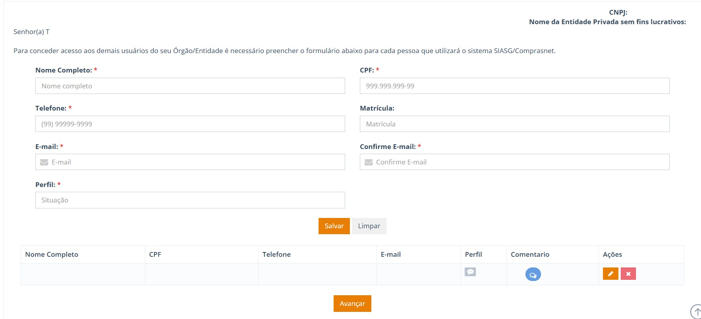

  Tamanho do texto:
  <button onclick="diminuirFonte()" title="Diminuir texto" style="padding: 6px 12px; font-weight: bold; cursor: pointer; border: 1px solid #ccc; border-radius: 4px; background: #f8f9fa;">A-</button>
  <button onclick="resetarFonte()" title="Tamanho normal" style="padding: 6px 12px; font-weight: bold; cursor: pointer; border: 1px solid #ccc; border-radius: 4px; background: #f8f9fa;">A</button>
  <button onclick="aumentarFonte()" title="Aumentar texto" style="padding: 6px 12px; font-weight: bold; cursor: pointer; border: 1px solid #ccc; border-radius: 4px; background: #f8f9fa;">A+</button>
  
  <button onclick="window.print()" style="background-color: #0056b3; color: white; padding: 6px 16px; border: none; border-radius: 5px; font-size: 14px; cursor: pointer; box-shadow: 0 2px 4px rgba(0,0,0,0.2); margin-left: 10px;">
    🖨️ Imprimir ou baixar esta página
  </button>

!!! note "Quem deve ler esta parte"
    **Nota:** Servidores, gestores e colaboradores de órgãos e entidades que precisam solicitar a adesão ao SGA, cadastrar usuários ou gerenciar perfis de acesso.

PARTE 1: GUIA PRÁTICO DO USUÁRIO E DO GESTOR

<h1 id="secao-3" style="margin-top: 0;">3. COMO CADASTRAR UM USUÁRIO?</h1>

**Assuntos relacionados:** [Qual perfil devo solicitar?](04-qual-perfil-devo-solicitar.md#secao-4)

!!! warning "ATENÇÃO"
    **Atenção:** É obrigatório cadastrar pelo menos um usuário antes de prosseguir.

---

## Passo a passo para cadastro

1. **Preencha os dados:** Informe nome, CPF, telefone, matrícula e e-mail.
2. **Selecione o perfil:** Escolha o perfil de acordo com a atividade que a pessoa vai realizar.
3. **Anexe o documento, quando exigido:** Perfis como Pregoeiro/Agente de Contratação e Homologador exigem documentos específicos (veja a [seção 4](04-qual-perfil-devo-solicitar.md#secao-4)).
4. **Salve:** Salve o cadastro. A tela continuará aberta para incluir outros usuários, se necessário.
5. **Avance:** Selecione “Avançar” quando terminar de cadastrar todos os usuários.

---

**CONFIRA:** Dados do usuário, perfil e documentos exigidos.  
**AÇÃO:** Selecione o perfil, salve e avance.

 

  <button onclick="window.print()" style="background-color: #0056b3; color: white; padding: 10px 20px; border: none; border-radius: 5px; font-size: 16px; cursor: pointer; box-shadow: 0 2px 4px rgba(0,0,0,0.2);">
    🖨️ Imprimir esta página
  </button>

