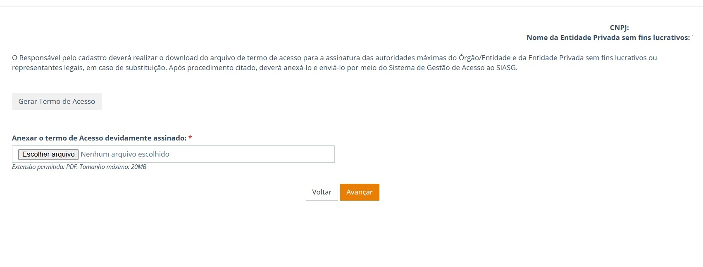

  Tamanho do texto:
  <button onclick="diminuirFonte()" title="Diminuir texto" style="padding: 6px 12px; font-weight: bold; cursor: pointer; border: 1px solid #ccc; border-radius: 4px; background: #f8f9fa;">A-</button>
  <button onclick="resetarFonte()" title="Tamanho normal" style="padding: 6px 12px; font-weight: bold; cursor: pointer; border: 1px solid #ccc; border-radius: 4px; background: #f8f9fa;">A</button>
  <button onclick="aumentarFonte()" title="Aumentar texto" style="padding: 6px 12px; font-weight: bold; cursor: pointer; border: 1px solid #ccc; border-radius: 4px; background: #f8f9fa;">A+</button>
  
  <button onclick="window.print()" style="background-color: #0056b3; color: white; padding: 6px 16px; border: none; border-radius: 5px; font-size: 14px; cursor: pointer; box-shadow: 0 2px 4px rgba(0,0,0,0.2); margin-left: 10px;">
    🖨️ Imprimir ou baixar esta página
  </button>

<h1 id="secao-5" style="margin-top: 0;">5. COMO GERAR E ENCAMINHAR O TERMO?</h1>

**Assuntos relacionados:** [Minha solicitação voltou. Como corrigir?](06-solicitacao-voltou-como-corrigir.md#secao-6) | [O que significa a situação apresentada?](07-o-que-significa-o-status.md#secao-7)

## Passo a passo para gerar e encaminhar o Termo

1. **Selecione “Gerar Termo de Acesso”:** O sistema baixará o documento para o seu dispositivo.
2. **Providencie a assinatura:** A autoridade máxima do órgão (ou representante legal, em caso de substituição) deve assinar. A assinatura pode ser física ou digital.
3. **Anexe o Termo assinado:** Depois da assinatura, anexe o Termo assinado em PDF, com até 20 MB.
4. **Selecione “Avançar”:** Após anexar o Termo assinado, selecione “Avançar” para enviá-lo para o administrador analisar.
5. **Acompanhe a análise do Termo:** Use a opção “Ir para o sistema”.

**CONFIRA:** O campo para anexar o documento assinado.  
**AÇÃO:** Escolha o arquivo e selecione “Avançar”.

!!! note "NÃO SABE SE A SOLICITAÇÃO FOI ENVIADA?"
    Consulte a situação da solicitação no SGA e verifique se há comentários ou pendências.

 

  <button onclick="window.print()" style="background-color: #0056b3; color: white; padding: 10px 20px; border: none; border-radius: 5px; font-size: 16px; cursor: pointer; box-shadow: 0 2px 4px rgba(0,0,0,0.2);">
    🖨️ Imprimir esta página
  </button>

