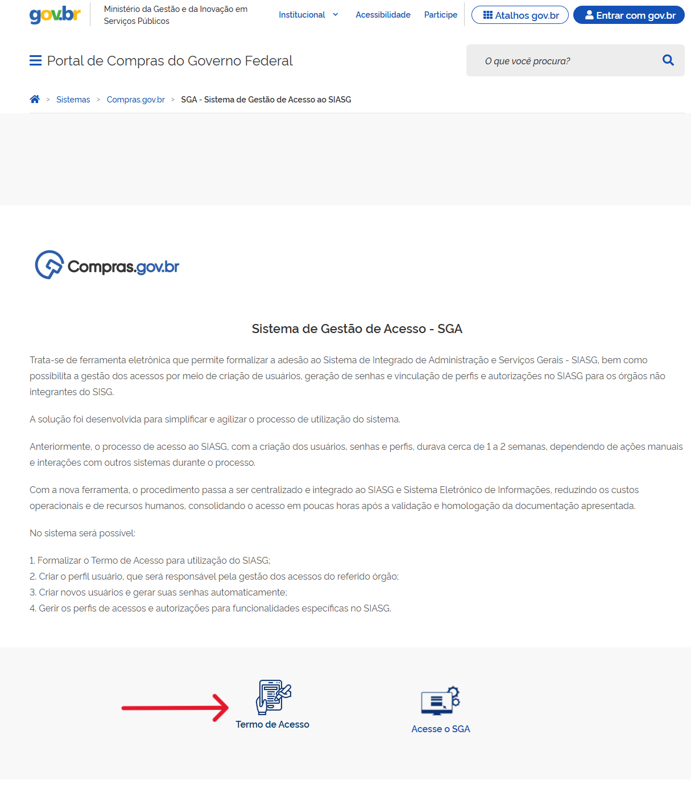
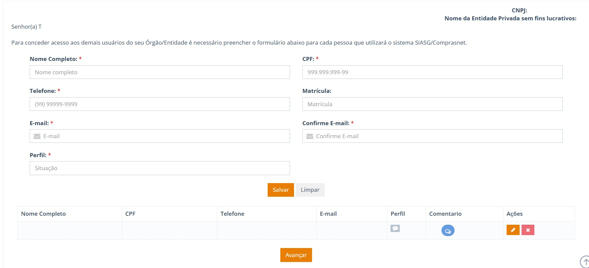
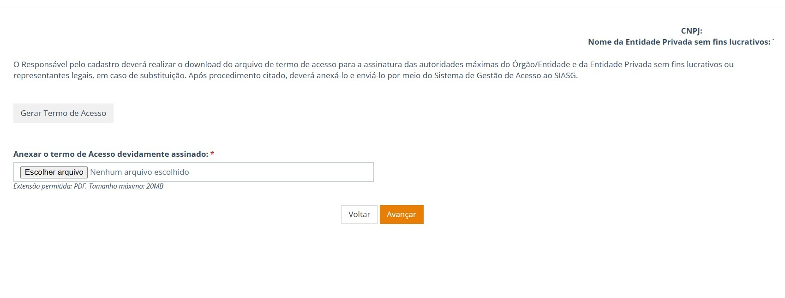

  Tamanho do texto:
  <button onclick="diminuirFonte()" title="Diminuir texto" style="padding: 6px 12px; font-weight: bold; cursor: pointer; border: 1px solid #ccc; border-radius: 4px; background: #f8f9fa;">A-</button>
  <button onclick="resetarFonte()" title="Tamanho normal" style="padding: 6px 12px; font-weight: bold; cursor: pointer; border: 1px solid #ccc; border-radius: 4px; background: #f8f9fa;">A</button>
  <button onclick="aumentarFonte()" title="Aumentar texto" style="padding: 6px 12px; font-weight: bold; cursor: pointer; border: 1px solid #ccc; border-radius: 4px; background: #f8f9fa;">A+</button>
  
  <button onclick="window.print()" style="background-color: #0056b3; color: white; padding: 6px 16px; border: none; border-radius: 5px; font-size: 14px; cursor: pointer; box-shadow: 0 2px 4px rgba(0,0,0,0.2); margin-left: 10px;">
    🖨️ Imprimir ou baixar esta página
  </button>

# GUIA 01 — SISTEMA DE GESTÃO DE ACESSO (SGA)

**Encontre sua situação. Veja a orientação. Faça a ação indicada.**

---

!!! note "PÚBLICO-ALVO"
    * Usuários
    * Central de Atendimento
    * Órgãos e entidades que acessam o Sistema Integrado de Administração de Serviços Gerais (SIASG)/Compras.gov.br
    * Gestores e operadores de estados e municípios.

---

<h2 id="como-usar-esta-cartilha">Como usar esta cartilha</h2>

Escolha no menu lateral ou nos links abaixo a pergunta que mais se aproxima da sua situação. Cada uma delas é uma seção que traz a resposta, o que conferir, o que fazer e quando pedir ajuda. Os destaques mostram os cuidados necessários, as exigências e os dados que você nunca deve enviar ao atendimento.

---

<h2 id="para-comecar">Para Começar</h2>

<h3 id="o-que-o-sga-faz">O que o SGA faz</h3>

O **Sistema de Gestão de Acesso (SGA)** é a ferramenta eletrônica usada para formalizar a adesão ao SIASG e gerenciar os acessos aos sistemas de compras do governo. No SGA, o responsável formaliza o Termo de Acesso, cadastra usuários e solicita perfis. Também acompanha solicitações e pendências.

Segundo a página oficial do SGA, o processo que antes levava cerca de 1 a 2 semanas passa a ser concluído em poucas horas após a validação da documentação apresentada.

!!! note "Termo de Acesso ou Termo de Adesão?"
    Nesta cartilha, **Termo de Acesso** é o nome do documento utilizado no SGA. Em orientações e comunicações mais antigas, ele pode aparecer como *Termo de Adesão*. Os dois nomes se referem ao documento usado para formalizar o acesso do órgão ou entidade ao SIASG.

---

<h3 id="quem-e-quem">Quem é quem</h3>

Conheça os principais papéis e suas funções:

- **Responsável do órgão:** Cadastra as informações e acompanha as solicitações.
- **Usuário:** Recebe os perfis necessários às atividades que realizará.
- **Administrador do SGA:** Analisa a solicitação e os documentos.

---

<h3 id="visao-geral-do-processo">Visão geral do processo</h3>

Antes de entrar nos detalhes, veja o caminho completo. Cada etapa corresponde a uma seção desta cartilha.

  
<strong>1. Formulário</strong>dados do órgão

  ▶
  
<strong>2. Usuários</strong>e perfis

  ▶
  
<strong>3. Termo</strong>gerar e assinar

  ▶
  
<strong>4. Análise</strong>administrador

  ▶
  
<strong>5. UASG</strong>e habilitação

  ▶
  
<strong>Finalizado</strong>novos pedidos

Se o administrador encontrar algo que precisa ser corrigido, ele devolve a solicitação ao responsável. Após a correção, o processo continua a partir da etapa 3. Veja a [seção 6: MINHA SOLICITAÇÃO VOLTOU. COMO CORRIGIR?](#secao-6)

---

<h3 id="antes-de-comecar">Antes de começar</h3>

Tenha em mãos antes de iniciar qualquer ação:

- [x] Dados do órgão ou entidade e do dirigente máximo (ou representante legal).
- [x] Dados do responsável: nome, CPF, cargo, telefone, data de nascimento e e-mail.
- [x] Conta Gov.br ativa do responsável (usada para entrar no SGA).
- [x] Dados de cada usuário: nome, CPF, telefone, matrícula e e-mail.
- [x] Atos de nomeação (ou Termo de Posse) para os perfis que exigem documento.
- [x] Meio de assinatura (física ou digital) pela autoridade máxima. O arquivo anexado deve estar em PDF, com até 20 MB.

---

## SUMÁRIO DE NAVEGAÇÃO

### Parte 1: Guia Prático do Usuário e do Gestor

1. [Seção 1 — Meu órgão precisa aderir ao SGA?](#secao-1)
2. [Seção 2 — Quem é o responsável pelo SGA?](#secao-2)
3. [Seção 3 — Como cadastrar um usuário?](#secao-3)
4. [Seção 4 — Qual perfil devo solicitar?](#secao-4)
5. [Seção 5 — Como gerar e encaminhar o termo?](#secao-5)
6. [Seção 6 — Minha solicitação voltou. Como corrigir?](#secao-6)
7. [Seção 7 — O que significa o status?](#secao-7)
8. [Seção 8 — Como solicitar novos usuários?](#secao-8)
9. [Seção 9 — Posso alterar usuários, perfis e responsáveis?](#secao-9)
10. [Seção 10 — Quando procurar a Central?](#secao-10)
11. [Seção 11 — Erros mais comuns e como evitá-los](#secao-11)
- [Perguntas Rápidas](#perguntas-rapidas)
- [Checklist de Verificação](#checklist-de-verificacao)
- [Glossário e Referências](#glossario)

---

### Parte 2: Roteiro de Apoio para a Central de Atendimento

12. [Seção 12 — Roteiro de apoio para a Central de Atendimento (0800)](#secao-12)

---

PARTE 1: GUIA PRÁTICO DO USUÁRIO E DO GESTOR

<h2 id="secao-1" style="margin-top: 0;">1. MEU ÓRGÃO PRECISA ADERIR AO SGA?</h2>

!!! note "RESPOSTA RÁPIDA"
    Órgãos e entidades federais integrantes do Sistema de Serviços Gerais (SISG) não precisam solicitar adesão pelo SGA. Os demais, de modo geral, precisam.

---

### Situação do Órgão ou Entidade

| SITUAÇÃO DO ÓRGÃO OU ENTIDADE | PRECISA SOLICITAR ADESÃO? |
| :--- | :--- |
| **Administração Pública Federal direta, autarquias e fundações públicas federais integrantes do SISG** | Não. Não precisam solicitar adesão pelo SGA. |
| **Órgãos e entidades estaduais e municipais** | De modo geral, sim. |
| **Empresas públicas e sociedades de economia mista** | Sim, conforme as regras aplicáveis a esse tipo de entidade. Confirme eventuais exceções na regulamentação do seu setor. |
| **Entidades privadas previstas na regulamentação** *(por exemplo, sem fins lucrativos que recebam recursos públicos de convênios ou outros acordos semelhantes)* | De modo geral, sim, conforme as regras aplicáveis a esse tipo de entidade. |
| **Serviços sociais autônomos** | De modo geral, sim, conforme as regras aplicáveis a esse tipo de entidade. |

!!! warning "ATENÇÃO"
    Alguns acordos podem prever exceções. Antes de começar, confirme se seu órgão ou entidade precisa solicitar a adesão. Em caso de dúvida, consulte a Central de Atendimento.

---

### O processo de adesão

1. **Preencha o formulário:** Informe os dados do órgão ou entidade, do dirigente e do responsável.
2. **Cadastre usuários e perfis:** Inclua pelo menos um usuário e defina o perfil de acesso.
3. **Gere o Termo:** Baixe o Termo de Acesso.
4. **Providencie a assinatura:** A assinatura pode ser física ou digital.
5. **Anexe e encaminhe:** Inclua o documento no SGA e envie para análise.
6. **Acompanhe:** Acompanhe a situação e corrija o que foi pedido.

---

**CONFIRA:** A opção “Termo de Acesso”.  
**AÇÃO:** Selecione a opção para iniciar o formulário.

---

<h2 id="secao-2">2. QUEM É O RESPONSÁVEL PELO SGA?</h2>

| DÚVIDA | ORIENTAÇÃO |
| :--- | :--- |
| **Quem pode ser responsável?** | É a pessoa que a autoridade do órgão ou entidade escolhe e indica formalmente para cuidar do cadastro do Termo de Acesso e dos perfis dos usuários. |
| **Posso cadastrar mais de um responsável?** | Sim. O sistema permite cadastrar mais de um responsável. Ter mais de um evita que o órgão fique sem acesso em caso de afastamento. |
| **Posso excluir todos os responsáveis?** | Não. Antes de excluir o último, cadastre um novo responsável ativo. Caso contrário, o órgão ficará sem acesso ao sistema. |
| **Como o responsável entra no SGA?** | O responsável acessa o SGA com uma conta ativa no Gov.br. |

---

!!! tip "DADOS DO RESPONSÁVEL"
    No cadastro de novo responsável, o sistema solicita: nome, CPF, cargo, telefone, data de nascimento e e-mail. De preferência, informe um e-mail institucional que você consulte regularmente. As notificações do SGA serão enviadas para esse endereço.

---

<h2 id="secao-3">3. COMO CADASTRAR UM USUÁRIO?</h2>

**Assuntos relacionados:** [Qual perfil devo solicitar?](#secao-4)

!!! warning "ATENÇÃO"
    É obrigatório cadastrar pelo menos um usuário antes de prosseguir.

---

### Passo a passo para cadastro

1. **Preencha os dados:** Informe nome, CPF, telefone, matrícula e e-mail.
2. **Selecione o perfil:** Escolha o perfil de acordo com a atividade que a pessoa vai realizar.
3. **Anexe o documento, quando exigido:** Perfis como Pregoeiro/Agente de Contratação e Homologador exigem documentos específicos (veja a [seção 4](#secao-4)).
4. **Salve:** Salve o cadastro. A tela continuará aberta para incluir outros usuários, se necessário.
5. **Avance:** Selecione “Avançar” quando terminar de cadastrar todos os usuários.

---

**CONFIRA:** Dados do usuário, perfil e documentos exigidos.  
**AÇÃO:** Selecione o perfil, salve e avance.

---

<h2 id="secao-4">4. QUAL PERFIL DEVO SOLICITAR?</h2>

**Assuntos relacionados:** [Como cadastrar um usuário?](#secao-3)

---

### Perfil por Atividade

Escolha o perfil conforme a atividade que será realizada:

| ATIVIDADE | PERFIL CORRESPONDENTE À ATIVIDADE |
| :--- | :--- |
| **Conduzir licitação eletrônica** | Pregoeiro / Agente de Contratação |
| **Receber, examinar e julgar documentos** | Presidente da Comissão de Contratação |
| **Adjudicar e homologar** | Homologador |
| **Somente visualizar informações** | Consulta |
| **Gerenciar atas de registro de preços** | Gestão de Atas |
| **Gerenciar usuários de uma unidade** | Administrador de Unidade |
| **Gerenciar usuários de todas as unidades do órgão** | Administrador do Órgão |
| **Atuar em contratação direta com disputa** | Dispensa Eletrônica |
| **Consultar fornecedores** | SICAF |
| **Autorizar publicação** | Autorizador do Órgão Comprador |
| **Cadastrar oportunidade e selecionar fornecedor** | Demandante do Órgão Comprador |

---

!!! note "DOCUMENTOS OBRIGATÓRIOS"
    * **Pregoeiro ou Agente de Contratação:** Ato de nomeação específico.
    * **Homologador:** Ato de nomeação ou Termo de Posse.

!!! tip "BOA PRÁTICA"
    Solicite apenas o perfil necessário para a atividade da pessoa. Perfis em excesso aumentam o risco de uso indevido e dificultam a gestão do órgão. Os perfis que aparecem na tela podem mudar conforme a versão do sistema; em caso de divergência, prevalece o que aparece no SGA e o Manual vigente.

---

<h2 id="secao-5">5. COMO GERAR E ENCAMINHAR O TERMO?</h2>

**Assuntos relacionados:** [Minha solicitação voltou. Como corrigir?](#secao-6) | [O que significa a situação apresentada?](#secao-7)

---

### Passo a passo para gerar e encaminhar o Termo

1. **Selecione “Gerar Termo de Acesso”:** O sistema baixará o documento para o seu dispositivo.
2. **Providencie a assinatura:** A autoridade máxima do órgão (ou representante legal, em caso de substituição) deve assinar. A assinatura pode ser física ou digital.
3. **Anexe o Termo assinado:** Depois da assinatura, anexe o Termo assinado em PDF, com até 20 MB.
4. **Selecione “Avançar”:** Após anexar o Termo assinado, selecione “Avançar” para enviá-lo para o administrador analisar.
5. **Acompanhe a análise do Termo:** Use a opção “Ir para o sistema”.

---

**CONFIRA:** O campo para anexar o documento assinado.  
**AÇÃO:** Escolha o arquivo e selecione “Avançar”.

---

!!! note "NÃO SABE SE A SOLICITAÇÃO FOI ENVIADA?"
    Consulte a situação da solicitação no SGA e verifique se há comentários ou pendências.

---

<h2 id="secao-6">6. MINHA SOLICITAÇÃO VOLTOU. COMO CORRIGIR?</h2>

**Assuntos relacionados:** [O que significa a situação apresentada?](#secao-7) | [Quando devo procurar a Central?](#secao-10)

!!! note "RESPOSTA RÁPIDA"
    Não abra outra solicitação. Corrija a solicitação que já existe e envie novamente.

---

### Passo a passo para correção

1. **Abra o comentário:** O comentário do administrador informa o que você precisa corrigir.
2. **Edite ou exclua o registro:** No campo “Ações”, edite o registro indicado no comentário. Exclua o registro apenas se for necessário para corrigir o problema.
3. **Salve as alterações:** Registre a correção no sistema.
4. **Avance:** Passe para a próxima etapa.
5. **Gere novamente o Termo:** Baixe, assine e anexe o documento corrigido.
6. **Finalize:** Encaminhe novamente ao administrador.

---

!!! note "MENSAGEM ESPERADA"
    Depois que você enviar a correção, o sistema mostrará a situação “Termo e usuário SIASG corrigidos”.

---

<h2 id="secao-7">7. O QUE SIGNIFICA O STATUS?</h2>

**Assuntos relacionados:** [Minha solicitação voltou. Como corrigir?](#secao-6) | [Quando devo procurar a Central?](#secao-10)

---

### Tabela de Situações e Encaminhamentos

| SITUAÇÃO | O QUE SIGNIFICA | QUEM AGE AGORA | O QUE VOCÊ DEVE FAZER |
| :--- | :--- | :--- | :--- |
| **Aguardando validação** | O administrador recebeu a solicitação e ainda precisa analisá-la. | Administrador MGI | Acompanhe pelo SGA e pelo e-mail cadastrado. |
| **Revalidar termo e usuário** | Termo devolvido com pendências. | Responsável do órgão | Identifique a pendência, corrija e reenvie. Veja a [seção 6](#secao-6). |
| **Termo e usuário SIASG corrigidos** | A correção foi enviada. Agora, o administrador precisa analisá-la novamente. | Administrador MGI | Acompanhe pelo SGA e pelo e-mail cadastrado. |
| **Termo e usuário SIASG válidos** | Aguardando a criação da UASG. | Administrador MGI | Acompanhe pelo SGA e pelo e-mail cadastrado. |
| **Aguardando habilitação do(s) usuário(s) SIASG** | UASG criada e aguardando ação do administrador. | Administrador MGI | Acompanhe pelo SGA e pelo e-mail cadastrado. |
| **Processo de solicitação de acesso finalizado** | Termo formalizado e pronto para novas solicitações. | Responsável do órgão | Acompanhe a liberação ou faça novas solicitações. |

---

!!! note "NOTIFICAÇÕES"
    O responsável recebe notificações sobre o andamento e as pendências no e-mail informado no cadastro. Confira também a pasta de spam, onde ficam as mensagens que o e-mail identifica como indesejadas.

---

<h2 id="secao-8">8. COMO SOLICITAR NOVOS USUÁRIOS?</h2>

**Assuntos relacionados:** [Posso alterar usuários, perfis e responsáveis?](#secao-9)

---

### Passo a passo para solicitar novos usuários

1. **Selecione “Solicitar novos usuários”:** A opção fica disponível depois que o processo do Termo de Acesso é concluído.
2. **Cadastre os usuários:** Preencha os campos e selecione os perfis.
3. **Gere o ofício:** Selecione “Ofício dos Novos Usuários SIASG”.
4. **Providencie a assinatura:** A autoridade competente deve assinar o ofício.
5. **Anexe e avance:** Encaminhe o documento para análise.
6. **Acompanhe:** Confira se há algo a corrigir e acompanhe a liberação dos acessos.

---

<h2 id="secao-9">9. POSSO ALTERAR USUÁRIOS, PERFIS E RESPONSÁVEIS?</h2>

**Assuntos relacionados:** [Como solicitar novos usuários?](#secao-8)

---

### Dúvidas frequentes sobre alteração de cadastros

| DÚVIDA | ORIENTAÇÃO |
| :--- | :--- |
| **Posso alterar dados de um usuário?** | Sim. Na gestão de usuários, é possível alterar nome, telefone, e-mail e matrícula. |
| **Posso alterar um perfil depois da validação?** | Sim, o responsável pode excluir ou alterar perfis. Para isso, apresente os documentos exigidos para o perfil. |
| **Posso vincular outra UASG?** | Quando aplicável, use a opção correspondente, selecione “Nova UASG”, defina o perfil e salve. |
| **Como incluir novo responsável?** | Acesse “Usuários SIASG” e “Gerenciar usuários responsáveis”, selecione “Cadastrar”, preencha os campos e salve. |
| **Como editar ou excluir responsável?** | Em “Gerenciar usuários responsáveis”, use “Editar” ou “Excluir”. Mantenha pelo menos um responsável ativo. Antes de excluir o último responsável cadastrado, cadastre um novo. |

---

<h2 id="secao-10">10. QUANDO PROCURAR A CENTRAL?</h2>

**Assuntos relacionados:** [Quais são os erros mais comuns?](#secao-11)

---

Procure a Central de Atendimento quando o problema não estiver relacionado às pendências apresentadas pelo SGA ou quando a orientação do próprio sistema não resolver a situação.

!!! note "CANAL DA CENTRAL DE ATENDIMENTO"
    **0800 978 9001**  
    Selecione a **opção 6 – Outros sistemas** e, depois, a **subopção 1 – SGA**.  
    *Para problemas de acesso à conta Gov.br, procure o suporte da própria conta no portal Gov.br.*

---

### Antes de pedir ajuda, reúna estas informações:

- [x] Órgão ou entidade.
- [x] Solicitação e usuário envolvidos.
- [x] Etapa em que você estava e qual função do sistema estava usando quando o problema ocorreu.
- [x] Mensagem ou comentário copiado exatamente como apresentado.
- [x] Data e horário aproximados.
- [x] O que você já tentou fazer.
- [x] Qual atividade você não consegue realizar por causa do problema.

---

!!! warning "SEGURANÇA"
    Nunca envie senha, código de autenticação ou credenciais de acesso — nem por e-mail, chamado, mensagem ou captura de tela. A equipe de atendimento nunca precisa desses dados.

---

<h2 id="secao-11">11. ERROS MAIS COMUNS E COMO EVITÁ-LOS</h2>

| ERRO FREQUENTE | CONSEQUÊNCIA | COMO EVITAR |
| :--- | :--- | :--- |
| **Abrir nova solicitação quando a primeira foi devolvida** | Dois pedidos para o mesmo caso e trabalho repetido | Corrija e reencaminhe a solicitação existente ([seção 6](#secao-6)). |
| **Esquecer de avançar ou enviar após anexar o Termo** | Solicitação não chega à análise | Após anexar o Termo, selecione “Avançar” e confira o status. |
| **Anexar o Termo sem assinatura da autoridade máxima** | Termo devolvido com pendência | Confirme assinatura e o formato PDF (até 20 MB) antes de anexar o Termo. |
| **Escolher perfil sem o documento exigido** | Usuário devolvido para correção | Separe o ato de nomeação ou Termo de Posse antes de começar. |
| **Excluir o único responsável** | Órgão fica sem acesso ao sistema | Cadastre o novo responsável antes de excluir o anterior. |
| **Não acompanhar o e-mail cadastrado** | Pendências não percebidas | De preferência, informe o e-mail institucional que você usa com frequência. Acompanhe também a situação da solicitação no SGA. |

---

<h2 id="perguntas-rapidas">PERGUNTAS RÁPIDAS</h2>

| PERGUNTA | RESPOSTA |
| :--- | :--- |
| **A conta Gov.br é obrigatória?** | Sim. O responsável precisa de conta ativa para acessar e acompanhar solicitações. |
| **Preciso anexar os documentos para continuar?** | Sim, quando o documento for obrigatório para aquela etapa ou perfil. Confira os documentos exigidos antes de avançar. |
| **Posso cadastrar mais de um responsável?** | Sim. |
| **Minha solicitação voltou. Devo abrir outra?** | Não. Corrija a solicitação existente e reencaminhe para nova análise (veja a [seção 6](#secao-6)). |
| **O sistema envia e-mail?** | Sim. O responsável recebe notificações no e-mail cadastrado. |
| **Posso alterar perfis depois?** | Sim, observando os documentos exigidos (veja a [seção 9](#secao-9)). |
| **Devo enviar minha senha ao atendimento?** | Não. Nunca. |

---

<h2 id="checklist-de-verificacao">CHECKLIST DE VERIFICAÇÃO</h2>

### Antes de enviar, confira:

- [x] Dados do órgão ou entidade preenchidos;
- [x] Dirigente e responsável corretamente identificados;
- [x] Pelo menos um usuário cadastrado;
- [x] Perfil adequado à atividade que a pessoa vai realizar;
- [x] Documentos obrigatórios anexados;
- [x] Termo ou ofício assinado, em PDF de até 20 MB.

---

!!! note "DEPOIS DE ENVIAR"
    Confirme o envio e acompanhe a situação da solicitação.

---

<h2 id="glossario">GLOSSÁRIO E REFERÊNCIAS</h2>

| TERMO | SIGNIFICADO |
| :--- | :--- |
| **SGA** | Sistema de Gestão de Acesso: ferramenta para adesão, cadastro de usuários e gestão de perfis no SIASG. |
| **SIASG** | Sistema Integrado de Administração de Serviços Gerais. |
| **SISG** | Sistema de Serviços Gerais, que reúne os órgãos federais integrantes. |
| **UASG** | Unidade Administrativa de Serviços Gerais: unidade cadastrada para operar nos sistemas de compras. |
| **Termo de Acesso** | Documento assinado pela autoridade máxima que formaliza o acesso do órgão ou entidade ao SIASG. |
| **Responsável** | Pessoa designada pelo órgão para gerir o Termo, os usuários e os perfis no SGA. |
| **Administrador** | Equipe que analisa o Termo e os usuários e conduz a criação da UASG e a habilitação. |
| **Perfil** | Conjunto de permissões associado à atividade que o usuário exerce. |
| **Gov.br** | Conta única de acesso do cidadão e do servidor aos serviços digitais do governo federal. |

---

### Quando esta cartilha não for suficiente

Consulte o Manual do SGA quando precisar de instruções mais detalhadas, explicações sobre os perfis, documentos exigidos ou outras telas do sistema.

- **Página oficial do SGA:** gov.br/compras — Sistema de Gestão de Acesso ao SIASG
- **Manuais do Portal de Compras:** gov.br/compras — Manuais
- **Perguntas frequentes do SIASG:** gov.br/compras — Perguntas frequentes
- **Guia de Atendimento 01 (Central de Atendimento):** material de apoio ao atendente.

---

### Referências

- BRASIL. Ministério da Gestão e da Inovação em Serviços Públicos. **Manual do Sistema de Gestão de Acesso (SGA)**, versão 1.0. Brasília, DF: Portal de Compras do Governo Federal, 2026. Disponível em: <https://www.gov.br/compras/pt-br/acesso-a-informacao/manuais>.
- BRASIL. Ministério da Gestão e da Inovação em Serviços Públicos. **Sistema de Gestão de Acesso ao SIASG (SGA)**. Brasília, DF: Portal de Compras do Governo Federal, [s.d.]. Disponível em: <https://www.gov.br/compras/pt-br/sistemas/sistema-de-gestao-de-acesso-ao-siasg-sga>.
- BRASIL. Ministério da Gestão e da Inovação em Serviços Públicos. **Perguntas frequentes: SIASG**. Brasília, DF: Portal de Compras do Governo Federal, [s.d.]. Disponível em: <https://www.gov.br/compras/pt-br/acesso-a-informacao/perguntas-frequentes/siasg>.
- BRASIL. **Portaria nº 355, de 9 de agosto de 2019**. Institui o Sistema de Gestão de Acesso (SGA) ao SIASG para os públicos abrangidos pela norma.
- BRASIL. Ministério da Gestão e da Inovação em Serviços Públicos. **Central de Atendimento**. Brasília, DF: MGI.

---

PARTE 2: ROTEIRO DE APOIO PARA A CENTRAL DE ATENDIMENTO

!!! note "Quem deve ler esta parte"
    Atendentes e integrantes da Central de Atendimento (0800), para padronizar as orientações prestadas aos usuários.

<h2 id="secao-12" style="margin-top: 0;">12. ROTEIRO DE APOIO PARA A CENTRAL DE ATENDIMENTO</h2>

Material de consulta rápida para atendentes. Use esse roteiro para dar orientações claras e seguir o mesmo padrão de atendimento. A análise da solicitação cabe ao administrador do SGA.

---

### Tabela de Orientação ao Atendente

| RELATO DO USUÁRIO | O QUE PERGUNTAR | ORIENTAÇÃO |
| :--- | :--- | :--- |
| **“Não sei se meu órgão precisa aderir.”** | O órgão integra o SISG? É estadual, municipal ou privado? | Orientar conforme a [seção 1](#secao-1); se houver exceção por acordo, encaminhar para confirmação. |
| **“Minha solicitação voltou.”** | Há comentário do administrador? Qual é o status? | Orientar a corrigir a solicitação existente ([seção 6](#secao-6)). Não abrir nova. |
| **“Não encontro o Termo.”** | A solicitação foi enviada? Há pendência? | Verificar envio, status e comentários ([seção 5](#secao-5)). |
| **“Qual perfil eu peço?”** | Qual atividade a pessoa vai exercer? | Apresentar a tabela de perfis ([seção 4](#secao-4)) e os documentos obrigatórios. |
| **“O status não muda.”** | Qual é o status e desde quando? | Explicar o significado e quem age ([seção 7](#secao-7)). Se a orientação não resolver, registrar e encaminhar. |
| **“Perdi o acesso ao SGA.”** | A conta Gov.br está ativa? Há outro responsável cadastrado? | Orientar a verificar a conta Gov.br e acionar outro responsável. Se o problema continuar, registre o caso. |

---

!!! tip "PADRÃO DE ATENDIMENTO"
    * **Registre sempre:** Órgão, solicitação, usuário, etapa, mensagem exata, data e horário, e o que já foi tentado.
    * **Segurança:** Nunca solicite senha, código de autenticação ou captura de tela com dados sensíveis.
    * **Perfil:** Não defina o perfil pelo usuário: o órgão deve escolher o perfil de acordo com a atividade da pessoa.

 

  <button onclick="window.print()" style="background-color: #0056b3; color: white; padding: 10px 20px; border: none; border-radius: 5px; font-size: 16px; cursor: pointer; box-shadow: 0 2px 4px rgba(0,0,0,0.2);">
    🖨️ Imprimir esta página
  </button>

